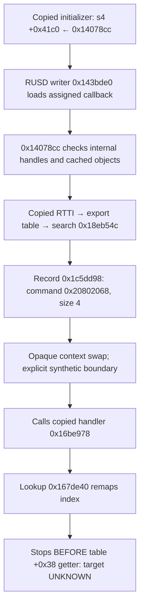

# Internal RM callback assignment and dispatch — 2026-10-21

Copied initialization code assigns **firmware target `0x14078cc` to object
`+0x41c0`**, the callback used by the recovered RUSD P-state writer. Its internal
handle path walks NVOC metadata, checks the parameter size and calls the selected
method. Bounded CPU execution now follows that assigned callback through actual
copied Subdevice metadata to P-state handler `0x16be978` and lookup `0x167de40`.
It stops before the unknown entry getter. The prior synthetic RM routing adapter
is no longer needed for this demonstrated path.

This is a static assignment and conditional synthetic route, not a captured
runtime pointer, complete constructor execution, hardware transaction or physical
value source. The second callback—the table object's `+0x38` getter—and writers
of returned entry `+0x34` remain unresolved.

## Artifact, preservation and domains

Copied input: `firmware-store/gsp-kernels/615-kernel-10.elf`, 17,305,752 bytes,
SHA-256 `4ac95cbbe55b5e61572053d0c8a410b4de7693eaa2881d1878c76b6405426f2a`.
It is the retained RM ELF from `gsp_ga10x.bin` 615.71.09, not asserted to be
GA102-exclusive. Every non-fixture VA here is a **firmware ELF VA**, not a live
GPU/MMIO or host-library address. Executable LOAD maps file `0 → VA 0x1000000`,
length `0xed2000`; writable LOAD maps file `0xed2000 → VA 0x4000000`, length
`0x1af000`. Per-range file offsets and bytes are retained.

Historical RTX 3090/GA102 identity is from earlier retained evidence. Historical
OS/privilege and current device/driver/GSP mode/workload/health are UNKNOWN and
were not queried. The `0x700...` object addresses and `0x7ffd0000` stop pointer in
emulation are explicitly synthetic. No new live data or timestamp is obtained.

Before edits, the full non-Git workspace, Git status/diffs/refs were preserved at
`../nvidia-callback-preserve-20261021-09cClt/`. Archive: 234,850,129 bytes,
SHA-256 `fcbd4bed118a5b22c1b4bad52f7216f3b7fdcb05cf355a8fc32ffe841b73c1d9`.
HEAD and fetched origin/main remain `d42161f2d6c0531eab3ed0b8c9c539ed52051e7d`,
including PR #4. Earlier packets are unchanged; no reset, clean, stash, commit,
push or production operation was performed.

## Claim ledger

| ID / status | Raw evidence and interpretation | Limit / unresolved distinction |
|---|---|---|
| CO-01 / source-decoded | Block `0x1aea74e–0x1aea7ec` copies 240 bytes from VA `0x4193d10` into base register s4 `+0x4188`, stores s4 as private context at `+0x4270`, initializes default security data, and assigns three function pointers. At `0x1aea7c6/0x1aea7ca`, AUIPC/ADDI computes `0x14078cc`; store at `0x1aea7ce` writes it to s4 `+0x41c0`. | Block entry uses a synthetic object base in s4. Earlier constructor paths, actual runtime object identity and later overwrites are not proven. The source copy region is zero in the retained ELF; its runtime initialization is unknown. Do not infer that other API slots are always zero/stubs. |
| CO-02 / source-decoded | Exact-source isolated `RM_API` compiles on the 64-bit CPU with size `0xf0`, Control `+0x38`, AllocWithHandle `+0x8`, Free `+0x18`, defaultSecInfo `+0xb8`, private context `+0xe8`. These match the binary: receiver `+0x4188`, Control at `+0x41c0`, private context at `+0x4270`. Other assigned targets are `0x14024b8` at `+0x4190` and `0x14024d8` at `+0x41a0`. | Host C layout is corroboration, not an independently compiled firmware ABI. Those other targets are assignment facts; their implementation/behavior is not analyzed here. |
| CO-03 / source-decoded | `0x14078cc` loads private context at API `+0xe8`; compares client/object against GPU-object `+0x4154/+0x415c`. Matching handles require nonnull cached pointers at `+0x4178/+0x4180`, walk class RTTI/cast metadata, call search `0x18eb54c`, check method parameter size, establish a context and invoke the selected function. The P-state record's handler is called at `0x1407b28`. | Handle mismatch takes a different indirect global API path; not traced/emulated here. No external reachability or authorization conclusion follows from an internal helper. Source names are correspondence labels, not recovered ELF symbols. |
| CO-04 / source-decoded | Actual copied class definition VA `0x1c64e70` and cast-info VA `0x1ec78f0` contain eight relative-class entries. The search consumes export count/table and 32-byte records with command at `+0x10`. For `0x20802068`, it returns record VA `0x1c5dd98` (file `0xc5dd98`): function `0x16be978`, size 4. | The immutable metadata is real copied evidence. Instance RTTI/reference pointers in the emulator are fixtures, not retained runtime pointers. This table remains one class/component, not all GPU controls or callable permissions. |
| CO-05 / source-decoded | Initializer block executes 177 copied instructions. Starting at writer `0x143bde0`, 539 copied instructions execute through its assigned callback `0x14078cc`, actual metadata/search, method `0x16be978` and lookup `0x167de40`, stopping with table receiver and remapped index 7 at the unknown getter boundary. | Object graph, handles, table index/type and cached pointers are synthetic. One opaque context-swap service at `0x18e57ec` is stopped and stubbed with success/old-context zero. The entry getter is never executed or given an invented implementation. |
| CO-06 / source-decoded | Copied helper `0x18eb54c` returns the expected entry address for all **1,183** commands in this class's table and null for **18** absent IDs. | Pure software/metadata verification, not 1,183 driver or hardware calls. It does not validate command payloads, consumers, permissions or per-SKU support. |
| CO-07 / source-decoded | Initializer default-security words are raw `(2,1)`, matching exact-source `RS_PRIV_LEVEL_KERNEL` and `PARAM_LOCATION_KERNEL`. Method path checks requested size against metadata before invoking the function. Source identifies missing-cached-state `0x40`, absent-method `0x56`, size mismatch `0x3a`. | Success path and search misses are emulated; dispatcher diagnostics/error tails are statically retained rather than exercised. Trusted internal context setup is not proof of a bypass, externally reachable privilege transition, or safe live call. |
| CO-08 / unresolved | Raw scans retain 338 SD `+0x1c0` candidates and 147 ADDI `+0x320` candidates. Only the control assignment above was promoted after instruction/dataflow and consumer checks. The earlier 210 SD `+0x320` matches and inspected perf-area candidates do not establish the entry getter's assignment. | Opcode patterns can be data, overlapping decodes, stack accesses or unrelated types. Absence of a selected pattern does not prove no assignment: alias arithmetic, out-parameters, factories and copies remain alternatives. |

The pointer arithmetic for CO-01 is explicit:
`0x1aea7c6 - 0x6e3000 + 0x106 = 0x14078cc`.
The store base is s4 `+0x4000`, displacement `0x1c0`; its receiver is s4
`+0x4188`, making callback displacement `0x38`. This is not a table selected
solely because its address looks plausible.



This advances the prior packet's unresolved RM dispatch assignment while keeping
the remaining getter, entry writers, timestamp source and runtime selection open.
The previous writer/publisher-to-host synthetic bridge remains separately valid;
it is not rerun here with a claimed real entry value.

## Primary source comparisons and security context

[source-manifest.json](source-manifest.json) records immutable URLs, commits,
file SHA-256/length and line-numbered excerpts. NVIDIA source is exact release
615.71.09, commit `61dcc93722ecb418bb5f2e00923f05b4b8051dd1`.

- `gpu.c:758–860,889–914`: `_gpuRmApiControl` uses internal handles/cached objects,
  exported-method lookup, parameter-size checks and context management;
  `_gpuInitPhysicalRmApi` copies an API interface, sets context/security and
  overrides Control/AllocWithHandle/Free. Multiple matching fields and consumer
  behavior support the correspondence; a nearby name alone does not.
- `rmapi.h:171–268` and `nvsecurityinfo.h:30–74`: exact source declaration and
  enum values underpin the layout check. [rmapi-layout.json](rmapi-layout.json)
  retains extracted/compiled C text, compiler version and all 12 vendor header
  dependency hashes. Only this CPU layout program was compiled, not a driver.
- `runtime.c:307–360`, `nvoc/rtti.h` and `nvoc/runtime.h`: public binary-search,
  inheritance traversal and strings-disabled record definitions agree with copied
  metadata and executable helper behavior. `nvstatuscodes.h:87,93,115` preserves
  the separate status identities; public `cl00de.h` and `ctrl2080perf.h` preserve
  the writer's command/parameter contract.

The public source has configuration-dependent guards, including a vGPU condition
around the shortcut. The retained firmware binary directly tests handles in this
compiled path. This is a configuration/implementation scope distinction, not
evidence that every build or architecture has identical guards. No claim of a
security vulnerability, complete policy recovery or public invocation permission
is made from this internal path.

Pinned Linux commit `7d0a66e4bb9081d75c82ec4957c50034cb0ea449`: nouveau r535
`ctrl.c` supplies generic GSP command/size/status transport correspondence; it is
not this firmware-internal shortcut implementation. Inspected nova-core `gsp.rs`
is a runtime placeholder and supplies no matching implementation for this check.
Neither independently establishes the concrete entry getter or physical source;
these scope limits apply to the retained commit/files, not all newer code.
The versioned RISC-V instruction reference recorded in the manifest supports
target arithmetic only. Existing signed-immediate tests check that arithmetic;
they do not establish NVIDIA object semantics.

## Raw artifacts and reproduction

- [control-assignment-01.json](control-assignment-01.json): initializer and
  dispatcher bytes, Capstone instructions, target arithmetic and file domains.
- [method-lookup-check.json](method-lookup-check.json): all 1,201 lookup results,
  eight raw cast relatives/class definitions and table identity.
- [dispatch-emulation.json](dispatch-emulation.json): exact initializer/route PCs,
  assigned pointer, default-security words and the single opaque context stub.
- `control-store-candidates.json`, `control-store-contexts.json`,
  `control-candidates-01.json`, `table-address-candidates.json`,
  `entry-candidates-01.json`: reproducible exploratory leads, not a proven CFG or
  object identity. Arbitrary contexts may start on overlapping instructions;
  bounded exports preserve `decoded_bytes` and `unparsed_tail_hex`, including
  ranges that cannot be fully decoded. No conclusion uses an unparsed tail.
- [method-lookup.json](method-lookup.json): raw search and surrounding retained
  instructions. Broader exploratory ranges contain neighboring functions; no
  whole-function or whole-program coverage claim follows from a range alone.

Capstone 5.0.7 disassembles RV64/RVC; Unicorn 2.1.4 runs the bounded code. The
emulator maps copied LOAD bytes read-only and enables execution only on selected
code pages; an instruction guard additionally restricts PCs to named routines.
Synthetic objects/stack are separate writable memory. A copied initializer slice
and its consumer run, not a firmware boot. Unknown code or exhausted budgets fail
closed, and no target binary is executed natively.

All extraction, emulation, layout compilation and checks run through the existing
CPU-only namespace wrapper: no network, GPU/device passthrough, host services,
sysfs, PCI resources, remote GPU access or production settings. No collector,
private live call, polling, tracer, injection, sudo, reset or firmware operation
was used. The unsupported REA RISC-V providers were not retried or reconfigured.

```sh
bash research/2026-10-21-callback-origins/reproduce.sh /tmp/new-callback-evidence
```

Requires a **new** output directory and existing hash-matched copied ELF/sources,
bwrap, Python/Capstone/Unicorn and C build tools. It installs/fetches nothing.
Ten analysis JSON files replayed byte-for-byte. The generated manifest records
the scripts and retained source/evidence inputs. [check.log](check.log) records
41 Python tests, 29 C record checks and remaining synthetic/C/CLI/syntax checks
passing. `SHA256SUMS` seals the packet; earlier packet checksums still validate.
The work remains uncommitted for review.

## Next offline action

Recover construction of the object loaded from GPU `+0x2000`, then the pointer
at its `+0x320` and callback at that table object's `+0x38`. Follow object-factory
arguments, out-parameters and initializer copies; two displacement-only angles
have not resolved that chain. Use RTTI/class or allocation evidence to establish
object identity before following entry `+0x34` writers. Preserve alternative
implementations and later callback replacement possibilities. If copied artifacts
do not retain enough initialization evidence, state the exact missing link and
continue another offline entry point—never inspect a live pointer to fill it.
