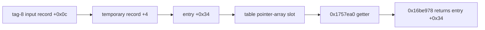

# Perf object, entry getter and constructor value provenance

This packet resolves one construction branch behind the getter left unresolved
by [CO-08](../2026-10-21-callback-origins/README.md), and locates one writer of
entry `+0x34`. It reaches an earlier tagged input record. It does not establish
a physical sensor/register, actual policy selection or every construction path.

The working branch starts at merged PR #5, commit
`6f8e387a693a03f9f5d9ec1f3e841f4c1b347292`, including PR #4. Work is in the
separate `nvidia-offline-object-origin-20261021` checkout. The original dirty
checkout and the previous publication checkout were left intact. Ignored copied
firmware/source files were copied into the new checkout; differing existing
files would have stopped that copy.

## Artifact and context

| Field | Evidence |
|---|---|
| Component | Copied RV64/RVC RM ELF from `gsp_ga10x` 615.71.09; not asserted GA102-exclusive |
| File | `firmware-store/gsp-kernels/615-kernel-10.elf`, 17,305,752 bytes |
| SHA-256 | `4ac95cbbe55b5e61572053d0c8a410b4de7693eaa2881d1878c76b6405426f2a` |
| Address domain | All instruction addresses below are **firmware ELF VA**, not host-library VA or live pointers |
| Mappings | File `0` → VA `0x1000000`, length `0xed2000`; file `0xed2000` → VA `0x4000000`, length `0x1af000` |
| Exact NVIDIA source | `61dcc93722ecb418bb5f2e00923f05b4b8051dd1`, release 615.71.09 |
| Historical board | Previously reported RTX 3090/GA102; no current identity observation |
| Current OS/driver/GSP mode/workload/health/privilege | UNKNOWN; not collected |
| Execution | CPU-only namespace; private `/dev`, no sysfs/network/host sockets/device passthrough |

All instance pointers beginning `0x700...`, feature bytes, allocator returns,
record contents and selection fields in the emulator are synthetic. Original
artifact bytes remain unchanged. [Source manifest](source-manifest.json) records
file hashes, immutable source URLs and analysis dependencies. [Raw exports](object-route.json)
include exact instruction bytes, hashes, file offsets and signed AUIPC target
calculations. Tool versions are in those exports and [emulation.json](emulation.json).

## Claim ledger

| ID | Status | Narrow finding and boundary |
|---|---|---|
| OO-01 | source-decoded; bounded argument check | The child-creation block passes class ID `0xed0b65` with output address GPU `+0x2000`. Exact public source names that ID `Perf`, separately from `KernelPerf` `0xc53a57`, whose output is GPU `+0x2008`. |
| OO-02 | observed-bytes; source-decoded | Retained `Perf` class definition VA `0x1cb0978`, file `0xcb0978`, size `0x90a28`, creator `0x1a0fedc`. GPU and KernelPerf metadata provide independent discriminators; this is not public/private layout equivalence. |
| OO-03 | source-decoded | The typed initialization path reaches `0x1be9250`, which has multiple table-building branches. One branch passes callback `0x1688714` into factory `0x1765820` and installs its result at Perf `+0x320`. Actual branch/feature selection remains unknown. |
| OO-04 | observed-bytes; bounded CPU reproduction | Callback `0x1688714` calls `0x1b0a460 → 0x1b0a2c0`; store `0x1b0a32e` assigns table `+0x38 = 0x1757ea0`. This prefix also establishes the pointer array at table `+8 = table+0x60`, capacity 32. Later overrides are not exhaustively excluded. |
| OO-05 | source-decoded; bounded CPU reproduction | Getter `0x1757ea0` checks the mapped index against `u16(table+0x18)` and loads `*(u64 *)(*(table+8)+8*index)`. On the successful populated path it returns that entry. Invalid index/null slot enters diagnostic code; those paths are never executed here. |
| OO-06 | source-decoded; bounded CPU reproduction | Entry constructor `0x16870d4` checks input byte `0 == 8`, copies `u32(input+0x0c)` to temporary `+4` at `0x1687200`, then to entry `+0x34` at `0x1687330`. The earlier input producer and complete later validation remain unresolved. |
| OO-07 | source-decoded; bounded CPU reproduction | Insertion `0x1680c20 → 0x17610dc` installs the entry into the same pointer array and builds the logical-index remapping used by `0x167de40`. With explicitly synthetic availability/current-index fields, the copied direct handler, lookup and resolved getter return the constructed word. |
| OO-08 | unresolved | Runtime construction, all alternate branches/overrides/writers, current-index policy and the tagged input's origin are unknown. These results do not prove a current physical state, sensor, MMIO read, external reachability or complete access/security map. |

## Object and construction chain

At `0x140dc1c`, the child-creation function saves its GPU argument into `s1`;
`s2` is `0x2000`. At `0x140dfd6..0x140dfea`, it supplies:

```
a0 = GPU
a1 = 0xed0b65             // exact-source class ID: Perf
a2 = 0                   // instance argument
a3 = GPU + 0x2000         // output pointer
call 0x1407d4c
```

The generic factory saves the output argument in `s2`, calls the dynamic creator,
casts by class ID and stores the resulting pointer at `0x1407e0a`. The adjacent
KernelPerf call instead passes `GPU+0x2008`. The exact-source comparison is
[`gpu.c:1414–1475, 1627–1667`](https://github.com/NVIDIA/open-gpu-kernel-modules/blob/61dcc93722ecb418bb5f2e00923f05b4b8051dd1/src/nvidia/src/kernel/gpu/gpu.c)
and the literal class IDs in
[`g_eng_desc_nvoc.h:312–323`](https://github.com/NVIDIA/open-gpu-kernel-modules/blob/61dcc93722ecb418bb5f2e00923f05b4b8051dd1/src/nvidia/generated/g_eng_desc_nvoc.h).

[metadata.json](metadata.json) retains the three class definitions, their cast
records and raw metadata. The Perf initializer stores its metadata pointer
`0x1caa550` at object `+0`, and its base metadata at `+8`. A base thunk at
`0x1a032fc` subtracts eight from the receiver and loads metadata `+0x110`, whose
retained value is `0x1667db8`. That function preserves GPU/Perf in `s2/s1` and
calls `0x1be9250` at `0x1668540`. The exact-target scan found one raw AUIPC/JALR
pair for that target; its surrounding caller dataflow is retained separately.
No guessed lifecycle name is needed to establish these pointers.

Inside `0x1be9250`, GPU and Perf are preserved in `s4/s1`. At
`0x1be9658..0x1be96f2`, it assembles factory arguments, including GPU, Perf and
additional object pointers, supplies constructor callback `0x1688714`, and
calls `0x1765820`. The generic factory calls that callback at `0x1765872`, then
uses interface methods to obtain table/header/entry records and construct and
insert entries. At `0x1be970a..0x1be970e`, the returned pointer is stored into
Perf `+0x320`. This is one conditional branch, not an unconditional constructor
for every device. An alternative visible branch calls `0x16a98ec`; it is not
assigned this branch's layout without further proof.

The selected callback requests `0x4c0` bytes, sets table fields and initializes
the common base. In `0x1b0a2c0`:

```
0x1b0a326 AUIPC a5, -0x3b2000
0x1b0a32a ADDI  a5, a5, -0x486  // target 0x1757ea0
0x1b0a32e SD    a5, 0x38(s1)
```

The typed layer supplies table `+8 = table+0x60`, `u16(+0x18)=32`. Its prefix
initializes the logical count/current-index words to `11`, a sentinel rejected
by `0x167de40`, and initializes remapping bytes to `11`. Construction alone
therefore does **not** make the direct getter available. The synthetic branch
sets type `0x50`; it is an observed byte assignment, not a proven VBIOS version.
The emulator stops before interface constructor `0x1767128`. It executes 1,064
copied instructions in this prefix, with only the heap allocator substituted.

## Entry input, storage and consumer

The table callback obtains interface `table+0x1e0`. Its setup assigns entry
factory `0x1768dd4` at interface `+0xa8`; that wrapper loads the input-record
pointer from a caller-provided pointer and calls interface `+0xf0`. The selected
table constructor assigns `0x16870d4` to that slot at `0x1688998`.

Within `0x16870d4`, the input record is held in `s5` and its first byte must be
`8` on the analyzed path. A `0xa98`-byte temporary record is allocated/zeroed;
input `+0x0c` is copied into temporary `+4`. Common entry construction
`0x17655b0` allocates/zeroes `0x10c0` bytes, sets entry index `+2` to `0xffff`
and returns its pointer. The caller saves this pointer in `s11`, computes a
byte from the highest set bit of temporary `+4`, and separately copies the
unchanged 32-bit word into `entry+0x34`.

The complete prefix from `0x16870d4` through the value stores now executes on
CPU, including the tag check, both allocator boundaries and copied memset/base
constructor. Execution stops **before** the next component getter at
`0x1687358`. No success of the entire entry constructor or input parser follows
from this prefix. The interface descriptor pointer in this experiment is an
explicit fixture using the copied descriptor passed by setup, not a runtime
snapshot or a substituted function body.

Insertion `0x1680c20` calls `0x17610dc`, which stores the entry pointer into
`*(table+8)+slot*8`, sets its index and mask, then updates the table's logical
index map. The copied handler consumes the same layout:



The synthetic checks insert at slot 7, build logical index 0's remapping, then
explicitly set current index 0 and clear Perf `+0x2d7`. These two selection
changes are fixture inputs; no settings or objects on a GPU are changed.
Five values (`1`, `4`, `256`, `3`, `0x80000000`) survive the copied constructor
prefix, insertion, remapping, getter and handler unchanged. Each insertion uses
105 copied instructions; each successful handler/lookup/getter uses 74. The
constructor prefix uses 3,242–3,334 instructions depending on the input word.

Raw `3` is copied despite not being one-hot. This shows no one-hot enforcement
in these bounded blocks; upstream parsing and later checks may still constrain
reachable inputs. It does not establish a firmware vulnerability or that raw
`3` occurs on hardware. The previous host conversion's invalid ordinal `32`
remains consistent with that synthetic input. Two further fixtures check the
disabled Perf gate (`0x56`) and logical index above count (`0x40`), both with
unchanged output and no entry-getter execution.

## Source comparisons and contradictions

* Exact NVIDIA source supplies class IDs, generic child creation/casting and
  NVOC metadata conventions. Public `KernelPerf` and private retained `Perf`
  have separate IDs and sizes. Their layouts must not be merged. The
  [RM P-state contract](https://github.com/NVIDIA/open-gpu-kernel-modules/blob/61dcc93722ecb418bb5f2e00923f05b4b8051dd1/src/common/sdk/nvidia/inc/ctrl/ctrl2080/ctrl2080perf.h)
  defines one-hot masks; this does not prove every internal record enforces them.
  [cl00de.h](https://github.com/NVIDIA/open-gpu-kernel-modules/blob/61dcc93722ecb418bb5f2e00923f05b4b8051dd1/src/common/sdk/nvidia/inc/class/cl00de.h)
  independently ties shared-data current P-state to command `0x20802068`.
* Pinned [nouveau BIOS parser](https://github.com/torvalds/linux/blob/7d0a66e4bb9081d75c82ec4957c50034cb0ea449/drivers/gpu/drm/nouveau/nvkm/subdev/bios/perf.c)
  reads a byte P-state field and interprets other fields according to table
  versions. This is a different demonstrated schema; it does not identify the
  firmware's tag-8 record or supply its missing producer. The retained r535
  transport source describes a control envelope, not this r615 constructor.
  The retained Nova GSP file at the same commit supplies no equivalent parser.
* Independent [envytools power-table parser](https://github.com/envytools/envytools/blob/f102b82381f3f11cee113d16374c87091db039d9/nvbios/power.c)
  decodes a BOOST-table P-state from a five-bit field. This reinforces the need
  to retain format-specific encodings. It is not corroboration of `input+0x0c`
  or a reason to equate the binary's type `0x50` with a BIOS version.
* Historical getter-log uncertainty is unchanged: no raw runtime pointer,
  shared record, table or constructor inputs were retained. Static/fixture
  agreement cannot establish which path that log used.

## Reproduce and remaining boundary

From the repository root, with the retained artifact/exact sources present:

```sh
bash research/2026-10-21-object-origin/reproduce.sh /tmp/object-origin-replay
```

The destination must be new. All parsing/disassembly/emulation/tests run in the
CPU-only wrapper. The host writes output files; no firmware service or vendor
library is loaded/executed natively. The allocator is explicitly modeled, and a
PC allowlist rejects excursions into diagnostics, special-service and hardware
paths. Never invoke the retained firmware or probe the running objects to fill
the gaps.

The seven JSON products replay byte-for-byte. The repository CPU gate passes
41 Python tests, C/CLI checks and 29 offline-record checks. See [check.log](check.log).
The packet is sealed by [SHA256SUMS](SHA256SUMS); earlier packets remain unchanged.

**Next offline action:** trace the producer of the tag-8 input record reaching
`0x16870d4`, starting with the record pointer returned through the parsed-table
callback at `0x176591c` and the selected interface methods. Retain its original
bytes/format and any validation before naming it VBIOS, policy, sensor or wire
data. Then trace current-index `+0x194` selection and gate `Perf+0x2d7` clearing.
Nearby-version GA102 boot equality remains a separate earlier result; none of
these new private offsets is transferred to a different firmware release.
