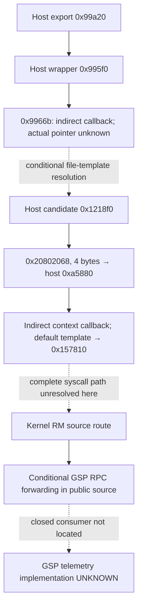

# Offline control-plane and GA102 boot packet — 2026-10-21

The corrected map survives the static recheck: discovery controls are not BoardObj
enumeration, the cited NVML addresses are host x86-64 addresses, and the telemetry
path is not proven through the closed GSP consumer. New evidence separates two
previously conflated host tables and decodes a compressed boot descriptor. The
GA102 PROD boot image and descriptor are identical in nearby releases 615.71.09
and 615.78.08. No hardware was contacted.

## Integration and preservation

Initial HEAD was `12301b3c4857331d154258c695fc8fb97e93e75a`; status, staged diff
and unstaged diff were empty. Ignored files were present. A full non-Git workspace
archive, diff/status/ref records, and preservation branch were created before the
fast-forward to `d42161f` (PR #4). Archive location:
`../nvidia-gpu-firmware-research-preserve-20261021T064004Z/workspace.tar.gz`,
190,750,320 bytes, SHA-256
`bf41b3901481fdfa933a9ffc9d0688b2adeb14d001298493cde6364a6e02a0b4`.
Branch: `preserve/pre-pr4-20261021T064004Z`. No reset, stash pop, clean, force push
or overwrite was used. Stale ignored `07-prototype/sniffer2.so` and `rmctl` were
moved to that preservation directory's `retired-builds/` after the safety gate
detected them; their bytes remain in the archive as well.

## Claim ledger and telemetry boundary

Artifact: copied `firmware-store/gsp-kernels/libnvidia-ml-615.71.09.so`,
2,958,776 bytes, SHA-256
`283793c0c30dc32f87c0e9fc9b5326fe764bad156e61afa3e997684c47b29a95`.
Every VA below is a **host-library link-time ELF VA**. Runtime ASLR load bias is
UNKNOWN. No value below is a GSP VA. Code VAs equal file offsets in the executable
LOAD segment; the writable LOAD segment maps file `0x21dad0` to VA `0x21ead0`.

Context limits: RTX 3090/GA102 and UUID are historical reported identity. Original
capture OS and privilege context are UNKNOWN from the retained text; current GPU
state, workload state and active GSP mode were not queried. Library version is
the copied artifact's label; source release and boot-source architecture are
separate provenance. No cross-SKU or all-architecture compatibility is inferred.

| ID / status | Evidence and interpretation | Limit / unknown |
|---|---|---|
| CP-01 / source-decoded | NVIDIA `ctrl0000gpu.h:315,358,362` defines `0x214` as GPU_GET_PROBED_IDS and `0x21b` as GPU_GET_PCI_INFO, with `{u32 gpuId, u32 domain, u16 bus, u16 slot}` for the latter. | No power/rail interpretation follows from this discovery sequence. |
| CP-02 / observed-bytes | The 55-pointer table really is at **file `0x2d1180`, VA `0x2d2180`**. Its first entries are `0x111d30, 0x111d10, 0x111cf0, 0x111600`. | Historical per-slot semantic names remain candidates. |
| CP-03 / source-decoded | `0x1529f6` sets count `0x37`; `0x152a02` selects **VA `0x2d1180`, file `0x2d0180`** and copies 55 qwords. This mixed template starts with `0x1c3287, 0, 0x2d10e0, 0xa5720`. | This is a different object/template, not the flat function table in CP-02. The copy stores its pointer at device-record `+0x285e0`; the public wrapper uses `+0x28540`. Their runtime relationship is not demonstrated here. |
| CP-04 / source-decoded | Public export `nvmlDeviceGetPerformanceState` at `0x99a20` calls `0x995f0` at `0x99a76`. Wrapper `0x99643–0x9966b` loads device `+0x28540`, then object `+0x170`, then table `+0x48`, and calls it indirectly after validation. | **This first indirect call is the proven boundary on that branch.** Actual runtime pointer contents are not retained. |
| CP-05 / source-decoded | File-template relocations give `VA 0x2d12f0 → 0x2d2060`, and `0x2d20a8 → 0x1218f0`. Thus a template with that root and slot layout selects the candidate callback. At `0x121b3b`, that callback sets command `0x20802068`; `0x121b47` sets payload length 4; `0x121b59` calls `0xa5880`. | This resolves a **conditional template path**. It does not establish that the historical getter selected that template or branch. |
| CP-06 / source-decoded | `0xa58fa` invokes another callback at context `+0x20`. The file template's context is `0x2d10e0`, slot `0x2d1100 → 0xa5600`, whose direct jump targets host dispatcher `0x157810`. | The complete command-specific route from this dispatcher to its syscall is not exported/proven in this packet. Never label this callback or dispatcher a firmware implementation. |
| CP-07 / source-decoded | Success jump-table entry for status zero at `0x1ec0ec` selects `0x121c68`: raw four-byte result → `0x376e0` conversion → caller output. CPU execution of only that conversion maps `1<<n → n`, for n=0..15, and invalid inputs → 32. | Synthetic inputs validate software conversion only; no current P-state was measured. |
| CP-08 / observed-bytes | Retained interleaved log reports RTX 3090 UUID `GPU-8a9c05b3-fea1-4d89-5113-b56acbb1eba9`, getter `rv=0`, ordinal `raw_pstate=0x8` five times. First getter interval contains logged `0xd01`, `0x4e`, `0xde0001`; repeats contain no logged calls. | No logged `0x20802068` occurs in those getter intervals. The log is text, not full pointer-buffer/mapping evidence; cache, shared memory, alternate callback and instrumentation limits remain alternatives. No claim of current workload continuity or fresh identity validation. |

Raw instructions, code-range hashes, relocation records, table bytes and capture
hashes are in [host-evidence.json](host-evidence.json). Objdump's nearest exported
symbol suffixes inside stripped code are display labels, not recovered function
names. The actual conversion execution and its table are in
[pstate-emulation.json](pstate-emulation.json). The success jump-table offset is
checked by reading its signed LE displacement; it is not inferred from proximity.

## Public driver comparison and security boundary

The pinned NVIDIA tree `ca2d03e6fafd4d4b56b383497d931c25b283bfcf` identifies itself
as **615.78.08**, not the copied library's 615.71.09. The exact 615.71.09 source
commit is `61dcc93722ecb418bb5f2e00923f05b4b8051dd1`. These are nearby-source
comparisons, not proof that the installed driver matches a source build.

At ca2d03e:

- `escape.c:796–844` validates NVOS54 extent and control-device context before
  `Nv04ControlWithSecInfo`. `control.c:745–835` includes access-right checks,
  virtual-GPU routing restrictions, a GPU command allowlist, internal-call rules
  and privilege checks. A command called GET does not bypass these boundaries.
- `g_subdevice_nvoc.c:11266–11282` associates `0x20802068` with a four-byte
  parameter structure and flags `0x50048`. The flags include
  `RMCTRL_FLAGS_ROUTE_TO_PHYSICAL=0x40` (`control.h:230`).
- `resource.c:254–301` forwards through `NV_RM_RPC_CONTROL` when the GPU is a
  firmware client and the route flag is set. This occurs in the resource prologue;
  the non-VF local `NV_ERR_NOT_SUPPORTED` stub is **not** evidence that the
  offloaded control lacks an implementation.
- `vgpu/rpc.c:10656–10873`, `rpcRmApiControl_GSP`, builds the GSP_RM_CONTROL
  envelope, records handles/command/length/flags, copies or serializes parameters,
  and distinguishes transfer status from handler status. The VF implementation
  `RmRpcPerfGetCurrentPstate` at `9054–9063` reads shared memory. Its name alone
  therefore does not mean that each invocation issues an RPC.

Linux/nouveau comparison: immutable Linux v6.18 commit
`7d0a66e4bb9081d75c82ec4957c50034cb0ea449`,
`drivers/gpu/drm/nouveau/nvkm/subdev/gsp/rm/r535/ctrl.c:38–85`, separately builds
a GSP_RM_CONTROL request with client/object/command/paramsSize and checks returned
status. This corroborates the generic transport model, **not** the NVML callback
choice, an r615 private ABI, a live request, or the firmware dispatch target.
No nova-specific semantic equivalence is claimed from the Nouveau converter's
mention of Nova; no nova telemetry implementation was inspected in this packet.

## Nearby GA102 PROD boot comparison

Both releases' `g_bindata_kgspGetBinArchiveGspRmBoot_GA102.c` were parsed as
little-endian NvU64 storage. The public NVIDIA Nouveau extractor explains gzip
framing. The declared compressed lengths remove padding; CRC32 and ISIZE are
validated. Full source-file hashes differ, while these two decoded components do
not. Debug variants and complete GSP-RM containers were not compared here.

| Component | Array storage / compressed / decoded bytes | Decoded SHA-256, identical in both releases |
|---|---|---|
| PROD image | 17,936 / 17,934 / 24,576 | `3df651acb174fd5f5561a1996965b192f50c5d763168446ed0d4ead19d895768` |
| PROD descriptor | 48 / 42 / 84 | `cc5a3fc1f4c47f2fe107b1b68f0176d8a448e6dec84b575e5560ccef5262bf15` |

Existing ignored `03-fmc/extracted/GspRmBoot_GA102_UCODE_{IMAGE,DESC}_PROD.bin`
match the **padded compressed storage** exactly. Their old names do not make
those bytes the decoded firmware/descriptor. Original files remain unchanged.

The 84-byte descriptor holds 21 LE u32 words. The versioned public structure
provides these names; all offsets below are **decoded component file offsets**.

| Fields | Raw decoded values |
|---|---|
| version, appVersion | `5`, `0` |
| bootloaderOffset, bootloaderSize | `0x5000`, `0x880` |
| bootloaderParamOffset, bootloaderParamSize | `0x5880`, `0x10` |
| riscvElfOffset, riscvElfSize | `0`, `0` |
| manifestOffset, manifestSize | `0`, `0x800` |
| monitorDataOffset, monitorDataSize | `0x800`, `0x1000` |
| monitorCodeOffset, monitorCodeSize | `0x1800`, `0x2900` |
| bIsMonitorEnabled | `1` |
| swbromCodeOffset/Size, swbromDataOffset/Size | all zero |
| fbReservedSize, bSignedAsCode | `0x6000`, `0` |

The current header also declares `bIsSmp` and `bIsPlicEnabled` after that prefix.
Those trailing fields are **absent** from the 84 bytes, not observed zeros.
Zero `bSignedAsCode` does not mean unsigned firmware, and the field named
manifest does not identify its signature scheme or key material. Region bounds
and per-region hashes are in [ga102-boot-comparison.json](ga102-boot-comparison.json).

Matched code evidence: the descriptor-selected bootloader begins with bytes
`37411800 1b010140 6f000010` (RV64 linear decode: `lui sp,0x184`,
`addiw sp,sp,0x400`, `j +0x100`). The first 128 bytes decode completely under the
RV64+RVC assumption and are identical across the releases, SHA-256
`cdb5d3c1aaef3f18ba48b8a536ffcfc8318861fec2b359586be433a069975d3d`.
This is a matched code block, not a claim of recovered function boundaries or
complete behavioral equivalence. Its file `0x500c` block loads literal-pool values
including `0x2000000000110408`, `0x2000000000820434` and `0x181400`.
The address tags, load mapping, register identities and meanings of tested bits
remain UNKNOWN; no tag was stripped to invent an MMIO register mapping.
See [ga102-boot-disassembly.json](ga102-boot-disassembly.json).

NVIDIA `kernel_gsp.c:6262–6308` obtains the selected image and descriptor through
bindata APIs; `bin_data.c:85–119` inflates compressed data to the declared buffer
size. `kernel_gsp_ga102.c:101–127` selects DBG or PROD labels under conditions;
no conditions were queried or changed. Nouveau's pinned `r535/gsp.c:1813–1841`
uses descriptor monitor-code/data/manifest offsets in its own boot package,
supporting the offset-based structure while leaving r615 compatibility unproven.
Independent envytools at `f102b82381f3f11cee113d16374c87091db039d9`,
`docs/hw/falcon/intro.rst`, describes older Falcon cores and optional crypto
hardware. It provides **no** validation of this RISC-V boot payload's encryption,
keys or register tags. Its scope limits prohibit carrying older Falcon AES
assumptions into these bytes. Opaque monitor/manifest content stays opaque.

## Reproduction, errors and next offline work

[source-manifest.json](source-manifest.json) records 24 inspected source files,
immutable commits, paths, URLs, lengths and hashes. Sources and original binaries
remain in ignored local storage. Reacquire source at the exact URLs; generated
excerpts identify their boundaries. Tools: GNU objdump/readelf 2.46, Capstone 5.0.7,
Unicorn 2.1.4, Python 3.14. All analysis commands use `run_cpu_only.sh`: new user,
PID, mount and network namespaces, synthetic `/dev`, isolated procfs, empty `/tmp`,
no host sysfs/home/service mounts, and the repository mounted read-only.

Run `bash research/2026-10-21-offline/reproduce.sh /tmp/NEW-DIRECTORY` from the
repository on this Linux CPU environment. It refuses an existing output directory.
The standard gate plus bindata bounds/CRC/padding/version fixtures runs there:
35 Python tests, 29 C record checks, synthetic payload checks, P-state C checks,
offline CLI/refusal checks and shell syntax checks passed. The separate Unicorn
run completed 20 synthetic inputs, and all four generated JSON exports reproduced.
The actual captured final gate output is retained in `check.log`; it is not a
hardware test. Neither target library nor boot code is executed natively.

Recorded tool limitations: REA returned `target_unavailable/ENOENT` for the local
copy path; no sudo, provider reconfiguration or process attachment followed.
Two obsolete Linux source-path requests returned 404; directory inspection
resolved the reorganized `rm/r535/` location. The initial gate found preserved
stale builds; a later isolated attempt lacked `/etc/alternatives/cc`. The final
namespace exposes that compiler symlink directory read-only, and passes the gate.
These were offline tooling errors; there was no live collection or recovery.

Next offline action: recover assignment to device `+0x28540` and the complete
`0x157810` dispatcher path for `0x20802068`, retaining relocation/branch evidence.
Then locate the matching GSP dispatcher by artifact hash, or state the precise
missing link. Separately, resolve the boot code's tagged pointer address space
from a public loader/address-map consumer before assigning register names.
