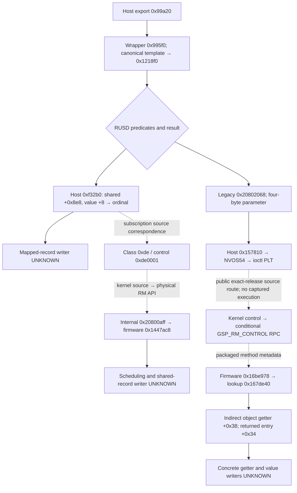

# P-state host dispatch, RUSD and retained GSP method map

The copied 615.71.09 library contains a shared-memory P-state reader as well as
the legacy `0x20802068` control route. Constructor arithmetic now connects the
previously mismatched template offsets. The retained RISC-V RM ELF contains a
source-compatible Subdevice export table with **1,183 records**, including the
direct P-state handler and both internal RUSD setup controls. This advances the
boundary from a host callback to a firmware object lookup. The firmware writer
of the shared P-state record and the physical origin of either value remain
unresolved. No live research or monitoring was performed.

## Inputs, domains and scope

| Copied input | Bytes | SHA-256 |
|---|---:|---|
| `firmware-store/gsp-kernels/libnvidia-ml-615.71.09.so` | 2,958,776 | `283793c0c30dc32f87c0e9fc9b5326fe764bad156e61afa3e997684c47b29a95` |
| `firmware-store/gsp-kernels/615-kernel-10.elf` | 17,305,752 | `4ac95cbbe55b5e61572053d0c8a410b4de7693eaa2881d1878c76b6405426f2a` |

Host addresses below are x86-64 **link-time host ELF VAs**, with unknown runtime
ASLR bias. Firmware addresses are **RISC-V firmware ELF VAs**. They are neither
host addresses nor demonstrated MMIO addresses. Firmware LOAD mappings are
file `0 → VA 0x1000000`, length `0xed2000`, and file `0xed2000 → VA 0x4000000`,
length `0x1af000`. Both domains and exact file offsets are retained per record.
Firmware provenance is the RM ELF previously extracted from copied
`gsp_ga10x.bin` 615.71.09; this common component is not asserted to be GA102-exclusive.

Historical log identity is RTX 3090, UUID
`GPU-8a9c05b3-fea1-4d89-5113-b56acbb1eba9`. Original OS and privilege context
are UNKNOWN. Current device identity, driver, GSP mode, workload, sensor contents
and health were not queried. Source is a separate, detached exact-release checkout:
NVIDIA commit `61dcc93722ecb418bb5f2e00923f05b4b8051dd1` (615.71.09).
The pre-existing vendor checkout at `ca2d03e6fafd4d4b56b383497d931c25b283bfcf`
is 615.78.08 and was left unchanged. Source correspondence is not runtime proof.

[source-manifest.json](source-manifest.json) records input hashes, retained-log
hash/length, immutable source URLs, 25 critical source files, analysis script
hashes and local tool versions. The export inventory additionally hashes all
207 public files inspected for literal identity annotation. Missing names stay null.

## Claim ledger

| ID / status | Evidence and interpretation | Boundary / competing explanation |
|---|---|---|
| PD-01 / source-decoded | Constructor `0x1528f0` copies the mixed template at `0x152a02`, then stores its allocated pointer at `s + i*0x93418 + 0x285e0`. Device record base is `s + 0xa0 + i*0x93418`, where `s` is host VA `0x2d2e20`. Thus that store is exactly device `+0x28540`. | Resolves CP-03's base-offset ambiguity in the earlier packet. The `0x31b9e` store is checkpoint restoration after clearing a record, not its initial template constructor. Historical runtime mutations remain unobserved. |
| PD-02 / source-decoded | Export `0x99a20 → wrapper 0x995f0 → indirect 0x9966b`: device `+0x28540 → root +0x170 → table +0x48`. Template pointers `0x2d12f0 → 0x2d2060`, `0x2d20a8 → 0x1218f0` identify the canonical static callback. | The file layout and constructor agree; no historical pointer snapshot proves actual callback selection. The separate flat table at file `0x2d1180` / host VA `0x2d2180` remains a different object. |
| PD-03 / source-decoded | `0x1218f0` tries the RUSD path first when its global/architecture/callback predicates permit; success returns immediately. Global `0x251648`, architecture gate `0x11e560(10)` and two callback predicates participate. Failed/unavailable RUSD rejoins the legacy path. | Architecture argument 10 is retained raw; no architecture enum invented. The fallback is not an unconditional control on every getter. |
| PD-04 / source-decoded | Template root `+0x120 → 0x2d1cc0`, slot `+0x30 → 0xf32b0`. This reader requests poll bit 2 via `0xf1b50`, then `0xf1db0` reads mapped base `device+0x286c0`, record offset `0x8e8`, length 16. Value at record `+8` passes through conversion `0x376e0`. | Exact header layout gives `NV00DE_SHARED_DATA.perfCurrentPstate`, size 3,184, matching the mapped length. Reader code does not reveal the firmware writer. |
| PD-05 / source-decoded | `0xf1b50` returns immediately if cached device mask `+0x8b728` already contains bit 2. Otherwise it initializes through `0xf17d0`, requests `0xde0001` with eight parameter bytes, then updates the cached mask on success. Init allocates classes `0x80`/`0xde` and maps 3,184 bytes. | This statically explains how repeated getter calls can avoid new controls. Class allocation, map and subscription were not executed. Initialization state/status at `+0x286c8/+0x286d0` and failure fallback are retained in IDA/raw exports. |
| PD-06 / source-decoded | The compiled `0xf1db0` reader makes at most five snapshot attempts with fences and timestamp recheck. Zero, write-in-progress and odd sequence timestamps fail; valid stable records succeed. Exhaustion returns raw 10 without changing caller output. Synthetic raw 4 becomes ordinal 2; raw 256 becomes 8. | Public `RUSD_READ_DATA` defaults to ten attempts; do not replace the compiled five with that default. Timestamp 1 succeeds: no age/freshness test exists in this reader. Composite raw 3 becomes ordinal 32 with status zero; no physical interpretation follows. |
| PD-07 / source-decoded | Legacy branch uses `0xa5880`, context `0x2d10e0+0x20 → 0xa5600 → 0x157810`. Its interception table has 22 nonzero records plus sentinel, with no `0x20802068`. Dispatcher builds `NVOS54` and reaches transport helper at `0x1585a8`: request `0xc020462a`, escape `0x2a`, envelope 32, payload four bytes. | Synthetic execution stops before helper `0x1567e0`. Raw instructions separately show `0x1567e0 → 0x1546e0 → 0x154800 → ioctl@plt` at `0x15483c`. No syscall, retries or driver result executed. |
| PD-08 / source-decoded | Firmware class definition VA `0x1c64e70` / file `0xc64e70` carries class ID `0x4b01b3`, matching public Subdevice metadata. Export info VA `0x1c62e38` references 1,183 sorted 32-byte records at VA `0x1c59658`. All retained function pointers are nonnull and map into executable LOAD. | Explicit strings-disabled NVOC schema checked against exact source. 638 generated method-name matches and 654 literal command-definition matches are separate counts. The public host-generated table has 656 entries; do not equate host and firmware inventories or call unmatched records necessarily private. |
| PD-09 / source-decoded | Export row 570 assigns `0x20802068`, parameter size 4, flags `0x50048`, access-right raw 0, handler firmware VA `0x16be978` / file `0x6be978`. Handler reaches helper `0x167de40`, then copies returned entry `+0x34` into caller payload `+0` on success. | This is a firmware object field, not a direct hardware register. Lookup ends at an indirect getter through object `+0x38`; its concrete implementation and field writers are unresolved. |
| PD-10 / source-decoded | Rows 396/397 map internal `0x20800afe/0x20800aff`, size 16 each, flags `0xc0`, to firmware `0x1447738/0x1447ac8`. Init code uses length `0xc70` (3,184). Poll code reads requested mask, bounds the interval to 100–1,000 and stores GPU-object `+0x42bc`; masks involve `+0x42a8`. | Interval units are source-decoded milliseconds from the exact internal params; no runtime interval measured. Synthetic same-mask/no-scheduler branches return success. Scheduler construction, callbacks and record writer remain untraced. |
| PD-11 / observed-bytes | The retained text log reports five successful ordinal-8 getter results; first interval logs `0xd01`, ioctl `0x4e` and `0xde0001`, repeated intervals log no controls; none logs `0x20802068`. | Consistent with the recovered RUSD path, but no raw shared-memory record, callback pointer, timestamp or poll-mask capture proves this historical branch. Clock remap, alternate selection and incomplete tracing are not disproved solely by a text log. |

These findings supersede the earlier packet's unresolved constructor relationship,
dispatcher-to-syscall gap and unlocated firmware method. The
[earlier packet](../2026-10-21-offline/README.md) and its raw evidence remain
unchanged as a dated checkpoint. The historical log still does not prove runtime
RUSD use. Discovery controls `0x214/0x21b` retain their corrected identities.

## Route and last demonstrated boundaries



The two firmware value boundaries are separate research targets; the direct
handler has not been proven to supply the shared record. Dotted edges express
source/static correspondence rather than an observed end-to-end transaction.
For the direct handler, parent `+0x160 → GPU +0xe8 → perf +0x2000`; absent perf
or perf byte `+0x2d7 != 0` returns `0x56` (`NV_ERR_NOT_SUPPORTED`). Table object
is perf `+0x320`, index is table `+0x194`. Helper rejects out-of-range index/count
and unsupported type; accepted index is remapped by byte `+0x181+index` before
tail-calling object `+0x38`. Null result returns `0x40` (`NV_ERR_INVALID_STATE`).
Type `0xff` bypasses a constant bitmap check; remaining type coverage is partial.

The direct helper target is decoded from AUIPC at firmware `0x16be9a0` and JALR
at `0x16be9a4`: `0x16be9a0 - 0x41000 + 0x4a0 = 0x167de40`.
The [versioned RISC-V ISA](https://docs.riscv.org/reference/isa/v20260120/unpriv/rv32.html)
supports that instruction arithmetic; it does not supply NVIDIA object semantics.

## Source comparison and access boundaries

Exact NVIDIA `cl00de.h` and `ctrl00de.h` provide the shared layout, bit 2 and
eight-byte user poll contract. A compiled C layout check confirms all offsets in
[layout.json](layout.json), including `NVOS54` fields at `0,4,8,12,16,24,28`.
Exact `gpu_user_shared_data.c:300–321,389–430` constructs the physical-init
control and cached system-memory mapping with `MEMDESC_FLAGS_USER_READ_ONLY`.
The user object's mask is combined with other clients/permanent requests before
the internal 16-byte poll control. Thus eight user bytes and sixteen internal
bytes are different interfaces, not a layout contradiction.

`escape.c:796–844` accepts `NVOS54` and invokes the security-aware control
entry; `resource.c:220–291` conditionally forwards physical controls;
`rpc.c:10654–10805` builds `GSP_RM_CONTROL` with client/object/command/size,
flags and serialized data. Cache/serialization/privilege branches are relevant:
a static default route does not prove a real call took every forwarding branch.
Firmware metadata flags `0xc0` decode to ROUTE_TO_PHYSICAL plus INTERNAL;
`0x50048` also includes NON_PRIVILEGED and two vGPU-related flags. These are
source-decoded access/routing attributes, not proof of callable permission or
authorization to exercise the controls. No security-bypass conclusion follows.

Linux/nouveau commit `7d0a66e4bb9081d75c82ec4957c50034cb0ea449` provides an
independent implementation of generic GSP RM control transport in r535 `ctrl.c`:
client/object/cmd/size/status agree at that abstract level. Its `gsp.c:2117–2119`
installs a NULL handler for the shared-data event, so this comparison supplies
neither a matching RUSD reader nor the missing firmware writer. It is not proof
of the r615 private ABI or an installed nouveau runtime. At the same pinned Linux
commit, nova-core `gsp.rs` declares an empty runtime placeholder; its inspected
`gsp/boot.rs` handles firmware/WPR setup, not the P-state record reader/writer.
The [directory receipt](source-receipts/nova-gsp-directory.json) retains the
inspected GSP directory listing. No nova-specific P-state writer implementation
has been established from these files; this is not a claim about all later nova
versions. Both files are retained/hash-recorded and were never built or executed. Retained
envytools Falcon references in the earlier packet do not decode RV64 RM code;
no cross-ISA corroboration is claimed.

The same-architecture nearby-release comparison remains the separately
[reproduced GA102 PROD GspRmBoot comparison](../2026-10-21-offline/ga102-boot-comparison.json):
decoded 24,576-byte image and 84-byte descriptor are byte-identical between
615.71.09 and 615.78.08. That result is specific to that boot component, not
equivalence of the RM ELF, trust policy, all firmware or runtime behavior.

## Tools, reproducibility and limitations

REA/IDA successfully opened the existing copied x86-64 library after using its
container-local path; [open-host evidence](rea/open-host.json) confirms the hash.
[Retained IDA pseudocode](rea/) is checked against the instruction bytes,
relocations and base arithmetic, not promoted solely from decompiler names.
Adapter version is 1; a verified IDA engine version is UNKNOWN. Static container
inspection reported privileged=false, no devices/device requests, no added
capabilities and no mounts; network mode was bridge. No container reconfiguration,
target process execution or debugger was used. REA is not claimed to have the
same no-network namespace as the local emulator.

The [RISC-V admission rejection](rea/riscv-admission.json) records Ghidra not
configured and a double-float profile mismatch, Hopper missing and its adapter
not admitting RISC-V, and IDA's adapter lacking a verified RISC-V lane. These are
current adapter limits, not universal product capabilities. No target flags were
altered or gates bypassed. Capstone 5.0.7 disassembles every byte in the retained
RV64/RVC ranges; Unicorn 2.1.4 runs bounded branches with synthetic memory.

All local extraction/emulation and the test gate execute through
`scripts/run_cpu_only.sh`: read-only repository, private namespaces, no network,
host services, GPU devices, `/sys`, PCI resources or host `/dev`. Target libraries
are never loaded natively. Files under `/tmp` and output redirection are ordinary
CPU artifacts. No sudo, monitoring collector, private control, polling service,
raw hardware access, firmware boot/load, settings or production operation ran.

Artifacts:

- [raw-evidence.json](raw-evidence.json): host bytes/objdump, pointer values,
  interception table and firmware bytes/Capstone instructions with file/VA mappings.
- [gsp-subdevice-exports.json](gsp-subdevice-exports.json): all 1,183 exact records,
  raw bytes, parameter sizes, flags, method pointers and literal public annotations.
- [rusd-emulation.json](rusd-emulation.json): ten snapshot fixtures, including
  unstable reads, invalid timestamps, ordinal conversion and untouched error output.
- [transport-emulation.json](transport-emulation.json): synthetic envelope and
  executed host PCs, stopping before the transport helper.
- [firmware-poll-emulation.json](firmware-poll-emulation.json): two bounded
  no-scheduler cases; no scheduling, timing or hardware polling occurs.
- [firmware-pstate-emulation.json](firmware-pstate-emulation.json): eight cases,
  checking early errors, range/type rejection, null return and entry `+0x34` copy.
  The unknown indirect getter is explicitly stubbed with a synthetic return.
  It is never executed; successful value flow is conditional on that stub.

Initial offline emulator stop pages containing illegal zero instructions produced
CPU exceptions. Replacing them with valid synthetic stop-page instructions let
the guard stop before the stub; exceptions and correction involved CPU memory
only. No hardware error or recovery action occurred. Other exploratory extent and
strict-header compilation errors were bounded offline; final scripts fail closed
and replay successfully. Emulation does not prove live object layout, complete
bitmap coverage, scheduler behavior, sensor validity, permissions or safety of a call.

Reproduce into a **new** directory (existing evidence is never overwritten):

```sh
bash research/2026-10-21-pstate-dispatch/reproduce.sh /tmp/new-pstate-evidence
```

Requires the hash-matched ignored artifacts, exact source checkout, retained
Linux files, bwrap, GNU tools, Capstone and Unicorn already available locally.
No automatic fetching, installation, driver build or live fallback occurs.
Seven analysis JSON outputs replayed byte-for-byte; the generated source manifest
also records the current scripts. IDA database/pseudocode exports are retained
provider evidence, not claimed byte-reproducible across fresh databases. The
[gate log](check.log) records 38 Python tests, 29 C record checks and remaining
synthetic/C/CLI/syntax checks passing. Packet files are listed in `SHA256SUMS`.

## Next offline action

Trace scheduler callbacks reachable from firmware `0x1447ac8` and locate stores to
the shared `perfCurrentPstate` record at offset `0x8e8`. Separately resolve the
concrete table-object getter at `+0x38` reached by `0x167de40` and the writers of
entry `+0x34`. Compare their value provenance before asserting they share a
measurement source. Export raw call targets and bytes at each step; stop at an
unresolved indirect target or absent retained code and take another offline angle.
This inventory is one class in one retained firmware component, not all low-level
GPU access, all security mechanisms or exhaustive firmware understanding.
