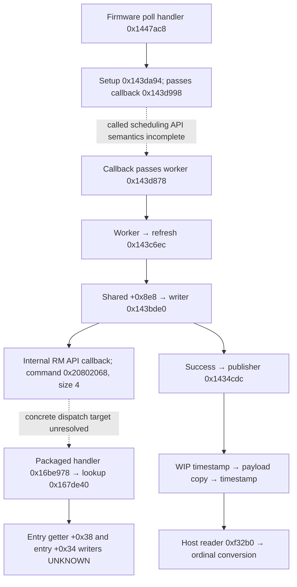

# Firmware P-state record writer — 2026-10-21

The retained RM firmware's RUSD writer is now located. Its helper requests
**control `0x20802068`, four bytes**, through an internal RM API callback and
publishes the returned value into shared `perfCurrentPstate`. This connects the
shared-memory path to the direct control's semantic contract. The concrete RM
API dispatch target, entry getter and underlying value writers remain unknown;
this is not yet a physical register or sensor origin.

Eight synthetic firmware cases and an x86 reader bridge reproduce publication,
invalidation and ordinal conversion without any GPU access. Prior uncommitted
work and evidence packets are preserved; this packet is additive.

## Artifacts and address domains

| Copied artifact | Bytes | SHA-256 |
|---|---:|---|
| `firmware-store/gsp-kernels/615-kernel-10.elf` | 17,305,752 | `4ac95cbbe55b5e61572053d0c8a410b4de7693eaa2881d1878c76b6405426f2a` |
| `firmware-store/gsp-kernels/libnvidia-ml-615.71.09.so` | 2,958,776 | `283793c0c30dc32f87c0e9fc9b5326fe764bad156e61afa3e997684c47b29a95` |

Every firmware address here is a **firmware ELF VA**, not a live hardware address.
The code LOAD maps file `0 → VA 0x1000000`, length `0xed2000`; writable LOAD maps
file `0xed2000 → VA 0x4000000`, length `0x1af000`. Thus writer `0x143bde0` is
file `0x43bde0`, publisher `0x1434cdc` is file `0x434cdc`, and direct method
`0x16be978` is file `0x6be978`. Host VAs in the bridge are separate x86-64 link-time
addresses, with unknown runtime ASLR bias.

RM ELF provenance remains the retained extraction from `gsp_ga10x.bin` 615.71.09;
not asserted to be GA102-exclusive. RTX 3090/GA102 is a historical reported board
identity, not a newly checked identity. Historical OS/privilege and current
device/driver/GSP mode/workload/health are UNKNOWN. Timestamp units and concrete
clock implementation are UNKNOWN. No retained live record is added here.

## Claim ledger

| ID / status | Raw evidence and interpretation | Limit / alternative |
|---|---|---|
| PW-01 / source-decoded | Poll handler `0x1447ac8` reaches setup routine `0x143da94`. Setup computes callback `0x143d998` at `0x143dfa4` and passes it to `0x18aa99c`. That callback computes worker `0x143d878` at `0x143d9ea` and passes it to `0x1acd2c4`. Worker calls refresh `0x143c6ec` at `0x143d92a`. | Function-pointer values and calls are decoded. Callback scheduling/lifetime semantics of the two called APIs are not fully recovered or emulated; no actual timer, thread or firmware service ran. |
| PW-02 / source-decoded | Worker loads shared base from GPU object `+0x42a0`, timer-like object from `+0x1f10`, requested mask from `+0x42a8`, and calls refresh. At `0x143c902–0x143c914`, refresh computes `0x1000-0x718 = 0x8e8`, adds its shared-buffer argument and passes it to helper `0x143bde0`. | Same offset as the public `NV00DE_SHARED_DATA.perfCurrentPstate` and copied NVML reader. Real buffer mapping/runtime arguments are not captured. |
| PW-03 / source-decoded | Helper tests mask bit 2. Enabled path loads internal callback from GPU object `+0x41c0`, supplies API receiver `gpu+0x4188`, client at `+0x4154`, object handle at `+0x415c`, command `0x20802068`, payload pointer and size 4; invokes it at `0x143be5a`. | Exact command/size prove a contract connection, not that the callback's concrete runtime target is the method-table handler. Its dispatch target remains unresolved. |
| PW-04 / source-decoded | On status zero, helper zeroes a 16-byte temporary, stores returned u32 at temporary `+8`, then calls publisher `0x1434cdc`. Publisher stores `UINT64_MAX` at record `+0`, fences, copies eight payload/padding bytes to `+8`, calls timestamp callback through timer-like object `+0x1a8`, fences, then stores that timestamp at `+0`. | Payload and timestamp provenance are separate. Byte-order/layout agree with source. Fences and instruction order do not prove real CPU/GPU coherence, timestamp age or sensor truth. Special-instruction/probe branches in the publisher are untraced. |
| PW-05 / source-decoded | Nonzero control status writes timestamp zero at `0x143be60`, leaving payload untouched. With mask bit 2 absent, third argument zero also invalidates; nonzero preserves the prior record. | Old payload bytes can remain present in an invalid record. The third argument is retained as a branch selector; no universal enum or lifecycle meaning assigned. Caller must honor validity, not interpret residual bytes as a new sample. |
| PW-06 / source-decoded | Copied firmware helper/publisher/memory utilities, direct handler `0x16be978` and lookup `0x167de40` run on synthetic memory. Successful fixtures publish raw 4/256; an explicit adapter connects internal command dispatch to the copied handler and another supplies its table entry. | RM dispatch, concrete object getter, timestamp and cached probe state are synthetic. This conditional integration checks code/data flow, not real dispatch selection or physical value provenance. |
| PW-07 / source-decoded | Passing the resulting 16 raw bytes into the copied x86 NVML reader returns ordinal 2/8 for raw 4/256. Zero-timestamp records return raw error 10 after five attempts without changing caller output. Stable raw composite 3 yields ordinal 32 with success. | Synthetic cross-ISA compatibility only. A retained timestamp/payload can still be accepted; there is no age test in this reader. No hardware observation, shared mapping or full public-wrapper execution is claimed. |
| PW-08 / unresolved | A raw halfword scan finds 210 candidate RV64 SD encodings with displacement `+0x320`. It has not identified the relevant perf-like object's construction or concrete table getter. | Same displacement is used by unrelated objects, stack frames and possibly data/overlapping decodes. None of these candidates is promoted to a proven writer merely from the match. |

The exact-source header explicitly documents `RUSD_PERF_CURRENT_PSTATE.currentPstate`
as provided by `NV2080_CTRL_CMD_PERF_GET_CURRENT_PSTATE`. The newly recovered code
supplies binary evidence for that statement; the earlier packet correctly left
the firmware writer unlocated. This closes that narrower gap while preserving
the missing concrete dispatch and physical-source boundaries.



The final firmware-to-host edge denotes an identical record contract, verified
with transferred synthetic bytes. It is not a captured runtime transfer.

## Source comparisons

[source-manifest.json](source-manifest.json) includes complete-file SHA-256/length,
immutable URLs, line-numbered excerpts and script hashes. NVIDIA source is exact
release 615.71.09 commit `61dcc93722ecb418bb5f2e00923f05b4b8051dd1`:

- `class/cl00de.h:142–146,425–449` specifies the command relationship, timestamp
  prefix, in-progress/invalid sentinels and shared field. `:528–540` defines
  validity; `ctrl2080perf.h:878–901` defines the four-byte control parameter.
- `gpu_user_shared_data.c:300–322,414–434` establishes the source-side physical
  init contract and cached, user-read-only system-memory allocation. It does not
  expose the recovered closed firmware writer's full implementation.
- `nvstatuscodes.h:93,115` identifies direct method statuses `0x40/0x56`. The
  NVML reader's raw 10 stays a separate host status domain.

Linux commit `7d0a66e4bb9081d75c82ec4957c50034cb0ea449`: nouveau r535 control
code supports generic command/size/status transport correspondence; it is not the
r615 private dispatch implementation. Its shared-data event installs a NULL
handler. Inspected nova-core `gsp.rs` has an empty runtime placeholder and its
`gsp/boot.rs` addresses boot/WPR setup. These sources do not independently prove
this RUSD writer, timestamp implementation or physical origin; do not generalize
that scope to later nova versions. Files and excerpts are retained and hashed.

AUIPC/JALR targets use signed immediate arithmetic from the
[versioned RISC-V ISA](https://docs.riscv.org/reference/isa/v20260120/unpriv/rv32.html).
Three added encoding tests check negative upper/low immediates, JALR low-bit
clearing and rejection of mismatched/nonadjacent pairs. This independently checks
the arithmetic, not NVIDIA semantics. The prior same-architecture GA102 PROD boot
comparison remains [byte-identical across the two releases](../2026-10-21-offline/ga102-boot-comparison.json);
no new equivalence claim about RM firmware versions is made here.

## Raw evidence, emulation and reproduction

- `scheduler-01/02/03.json`: bounded copied bytes, file/VA mappings, Capstone
  instructions and adjacent PC-relative references. These include the recovered
  callback pointers, worker and refresh range.
- `writer-01/02.json`, `emulated-ranges.json`, `copy-tail.json`: raw helper,
  publisher, direct handler/lookup and memory-utility instructions. Exported
  exploratory ranges can end with a two-byte partial instruction; exact
  `decoded_bytes` and `unparsed_tail_hex` retain that limitation. No whole-program
  CFG or complete function recovery is claimed from linear ranges.
- [writer-emulation.json](writer-emulation.json): eight cases, exact PCs,
  record write order, output canaries and every synthetic callback boundary.
- [writer-reader-bridge.json](writer-reader-bridge.json): the same raw record
  bytes consumed by copied host instructions; input JSON hash is recorded.
- [perf-pointer-store-candidates.json](perf-pointer-store-candidates.json): raw
  candidate encodings only, with limitations explicit.

All computations execute through `scripts/run_cpu_only.sh`: read-only copied
workspace, private namespaces and temporary memory/files, no network, hardware
devices, host services, sysfs, PCI resources or forwarded GPU access. Capstone
5.0.7 disassembles RV64/RVC; Unicorn 2.1.4 emulates both ISAs. No target binary is
loaded natively. No monitoring, private live call, injection, tracer, sudo,
firmware loading, settings change or production operation occurred.

The fixture sets a cached publisher flag at firmware VA `0x41ae3c0` to bypass an
unresolved special-instruction/probe path. It does not execute that path. Unknown
code PCs, callback types or exhausted instruction budgets fail closed. Callback
return values, timer timestamp and entry `+0x34` are invented **fixture inputs**,
never reported as observed GPU values. Copied memory utilities execute rather
than being silently replaced by host functions.

Exploratory tooling stopped on a Python module-name collision, unmapped retained
reference targets, partial instruction extents, an initially incomplete emulated
copy range and a null synthetic host context. These were offline tooling/fixture
issues. Final exports preserve unavailable mappings/partial tails explicitly and
the corrected harnesses replay successfully. No hardware error or remediation
occurred.

```sh
bash research/2026-10-21-pstate-writers/reproduce.sh /tmp/new-writer-evidence
```

The script requires a **new** destination and existing hash-matched artifacts,
retained sources, bwrap, Python/Capstone/Unicorn and build tools. It fetches and
installs nothing. Ten analysis JSON results replayed byte-for-byte in a fresh
directory. [check.log](check.log) records **41 Python tests, 29 C record checks**,
plus synthetic/C/CLI/syntax checks passing. `SHA256SUMS` seals this packet;
prior packet checksums remain valid. Work is left uncommitted for review.

## Next offline discriminator

Resolve the internal RM API callback loaded from GPU object `+0x41c0`, and the
concrete table entry getter at object `+0x38` used by `0x167de40`. Recover their
constructor/assignment chain or prove an exact indirect target before following
entry `+0x34` writers. Do not select a target from a displacement scan, public
type resemblance or nearby function names. If the relevant runtime pointer
cannot be recovered from copied artifacts, retain that unknown and trace the
firmware object/command construction from another static entry point.
